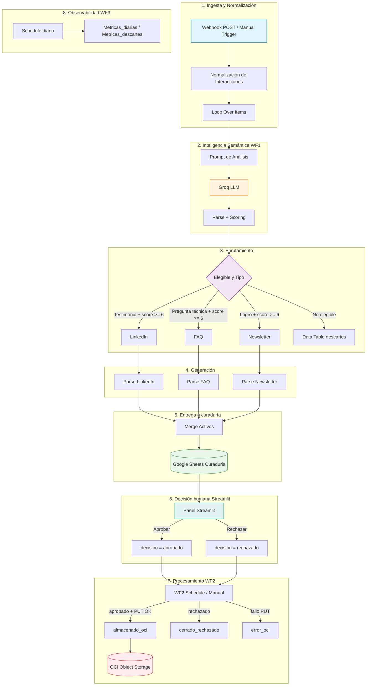

# 🛡️ CommunityLab
### Motor Inteligente de Transformación y Distribución para Comunidades Digitales

> **Hackathon ONE G10 · Oracle Next Education & Alura · Octubre 2026**  
> **Equipo 36**  
> *"La IA propone · El humano decide · OCI guarda solo lo aprobado."*

---

## 📌 ¿Qué es CommunityLab?

**CommunityLab** transforma la actividad orgánica de una comunidad digital (testimonios, dudas, logros dispersos en canales como Discord) en activos de marketing listos para distribución — de forma automatizada, con curación humana obligatoria y persistencia en la nube de Oracle.

> El sistema **genera** contenido, el curador **aprueba o rechaza**, y **OCI Object Storage** conserva solo lo aprobado.  
> **No publica automáticamente** en redes sociales externas.

| Recurso | URL | Nota |
|--------|-----|------|
| **Panel de curaduría (operativo)** | [g10-latam-equipo-36.streamlit.app](https://g10-latam-equipo-36.streamlit.app/) | Estación real de aprobación / rechazo |
| **Landing de presentación** | [proyecto-equipo-36.netlify.app](https://proyecto-equipo-36.netlify.app/) | **Vista demostrativa** (ver nota abajo) |
| **Repositorio** | [github.com/FerIqm1993/Proyecto-Equipo-36](https://github.com/FerIqm1993/Proyecto-Equipo-36) | Código y documentación |

### Nota sobre la landing (Netlify)

La landing pública es una **vista demostrativa de presentación**: puede incluir simulador, métricas ilustrativas o botones de ejemplo. **No es la interfaz operativa de curaduría** y no debe interpretarse como escritura en tiempo real sobre Google Sheets ni como publicación en OCI.

La curaduría operativa se realiza en el **panel Streamlit**. La persistencia en OCI la ejecuta **WF2 en n8n** tras una decisión humana registrada en Sheets.

---

## 🎯 Justificación y Propuesta de Valor

### El Problema

Las comunidades de aprendizaje tecnológico (Discord, Slack, foros, etc.) generan a diario interacciones de alto valor: testimonios de empleo, dudas técnicas recurrentes y logros de proyectos. Una parte importante de ese contenido **queda dispersa en el historial de los canales**, porque identificarlo, revisarlo y adaptarlo a formatos de comunicación requiere trabajo manual de Community Management.

### La Solución

**CommunityLab** implementa una arquitectura orientada a eventos con IA generativa y orquestación que:

1. **Ingiere y normaliza** interacciones (Webhook HTTP validado E2E + Manual Trigger; integración nativa con Discord **diseñada, pendiente**).
2. **Evalúa semánticamente** los mensajes con modelos LLM mediante la API de **Groq** y aplica scoring determinístico.
3. **Bifurca y genera** 3 formatos especializados:
   - 📢 **Post de LinkedIn** — testimonios de éxito profesional  
   - 💡 **FAQ / guía técnica** — dudas recurrentes  
   - 📰 **Destaque de newsletter** — logros y proyectos  
4. **Incorpora curaduría humana (HITL)** con dashboard **Streamlit** + Google Sheets.
5. **Persiste los activos aprobados** en **OCI Object Storage (Always Free)**.
6. **Consolida métricas diarias** (WF3) para monitoreo y BI.

---

## 🏛️ Arquitectura del Sistema



**Contrato de decisión**

- **Streamlit** registra la decisión humana en Google Sheets (`decision`, y campos de auditoría como `user` / `decision_at` / `comentario` cuando aplica).
- **WF2** procesa esa decisión y escribe el resultado operativo en `estado_proceso`:
  - aprobado + PUT verificado → `almacenado_oci`
  - rechazado → `cerrado_rechazado`
  - fallo de subida → `error_oci`

**Ingesta externa (solo WF1):** validada con cliente HTTP (ReqBin): `POST` → respuesta HTTP 200 con `{"message":"Workflow was started"}`.  
Eso acredita que el webhook **aceptó iniciar** el workflow. El procesamiento completo se acredita con la ejecución exitosa de WF1 y las filas en Curaduria; la persistencia, tras aprobación humana, con WF2 y el objeto en OCI (idealmente el mismo `execution_id` / `asset_id` en la cadena de evidencias).

Endpoint de referencia:

```text
POST https://equipo36.app.n8n.cloud/webhook/communitylab-ingesta
Content-Type: application/json
```

WF2 y WF3 **no** usan este webhook. Discord/Slack como fuente nativa: **diseñado, pendiente**.

---

## 📂 Estructura del Proyecto

```text
communitylab/
├── README.md
├── .gitignore
├── .env.example
├── workflows/
│   ├── WF1-ingesta-analisis-generacion.json
│   ├── WF2-curaduria-oci.json
│   ├── WF3-metricas-diarias.json
│   └── sample-payload-ingesta.json
├── dashboard/
│   ├── dashboard_curaduria.py
│   ├── requirements.txt
│   ├── README-dashboard.md
│   ├── plantilla_curaduria.csv
│   └── .streamlit/
│       └── secrets.toml.example
└── docs/
    ├── README.md
    └── capturas/
```

---

## ⚙️ Workflows de Automatización (n8n)

### 1. `WF1-ingesta-analisis-generacion.json`

- **Disparador:** Webhook HTTP (`POST /webhook/communitylab-ingesta`) o ejecución manual con dataset de prueba.
- **Normalización:** Homogeneiza autores, canales, tipos y timestamps; asigna `execution_id` con formato `CL-YYYYMMDD-XXX`.
- **Análisis semántico (Groq):** sentimiento, temas, `tipo_detectado`, `score_llm`, insight.
- **Scoring determinístico:**
  ```text
  score_final = 0.75 × score_llm + 0.25 × señal_tipo
  ```
  **Triple barrera de elegibilidad:** sentimiento `muy_positivo` o `positivo` · `score_final >= 6` · tipo en `testimonio` | `pregunta_tecnica` | `logro`.
- **Bifurcación:** tres generadores LLM (LinkedIn, FAQ, Newsletter).
- **Entrega a curaduría:** registra activos en Google Sheets (`pendiente_curaduria` / `pendiente_decision`).
- **Descartes:** Data Table con `motivo_descarte` clasificado.
- **Nota:** WF1 **no** escribe en OCI.

### 2. `WF2-curaduria-oci.json`

- **Disparador:** Schedule cada **15 minutos** + Manual Trigger.
- **Filtro:** filas con decisión humana explícita (p. ej. `decision = aprobado` y `estado_proceso = pendiente_decision`), más lógica de reproceso controlado para estados de error/diagnóstico.
- **OCI:** **PUT** a Object Storage mediante **Pre-Authenticated Request (PAR)** de **solo escritura**.
- **Ruta de objetos:**
  ```text
  activos/aprobados/{execution_id}/{asset_id}.json
  ```
- **Cierre de ciclo (resultado de WF2):**
  - Aprobado y PUT OK → `estado_proceso = almacenado_oci`
  - Rechazado → `cerrado_rechazado`
  - Fallo de subida → `error_oci` (reintentable)

### 3. `WF3-metricas-diarias.json`

- **Disparador:** Schedule diario.
- **Salida:** pestañas `Metricas_diarias` y `Metricas_descartes_diarias`.
- **Indicadores:** totales, pendientes, aprobados, rechazados, `almacenado_oci`, distribución por tipo, score promedio, embudo de motivos de descarte.
- Listo para conectar **Power BI / Looker Studio**.

---

## 🖥️ Módulo de Curaduría (Dashboard Streamlit)

El archivo [`dashboard/dashboard_curaduria.py`](dashboard/dashboard_curaduria.py) es la **estación operativa** de curaduría:

- Visualización de activos pendientes (LinkedIn / FAQ / Newsletter).
- Acciones **Aprobar** / **Rechazar** que escriben en Google Sheets.
- Posibilidad de editar el texto antes de decidir.
- **Contenido y OCI:** el panel trabaja sobre la fila del Sheet (`contenido` / `contenido_json`). La versión que WF2 empaqueta hacia OCI es la **versión aprobada presente en la fila** en el momento del procesamiento, junto con metadatos de auditoría cuando están disponibles. Si el flujo actual preserva además el original del LLM en `contenido_json`, ese campo permanece como rastro de generación.

**Actualización en Sheets:** se actualiza la fila seleccionada en el panel. Para integridad, se recomienda (y, si está implementado en el panel, se aplica) comprobar correspondencia con `execution_id` y `asset_id` antes de guardar cambios.

Guía: [`dashboard/README-dashboard.md`](dashboard/README-dashboard.md)  
**Panel en vivo:** [https://g10-latam-equipo-36.streamlit.app/](https://g10-latam-equipo-36.streamlit.app/)

---

## 📑 Acuerdos y Contratos de Datos (Data Contracts)

### Entrada al pipeline (Trigger)

```json
{
  "origen_comunidad": "Discord_Grupo_ONE_G10",
  "periodo_referencia": "Semana_04",
  "interacciones": [
    {
      "autor": "Mariana Souza",
      "canal": "#logros-y-empleos",
      "tipo": "testimonio",
      "texto": "Después de 8 meses aplicando lo que aprendí en el programa, firmé mi primera oferta como desarrolladora junior."
    }
  ]
}
```

### Salida del análisis semántico (LLM)

```json
{
  "sentimiento": "muy_positivo",
  "temas": ["empleo", "desarrollo", "carrera"],
  "tipo_detectado": "testimonio",
  "score_llm": 9,
  "insight": "Historia de inserción laboral con alta resonancia comunitaria"
}
```

### Ejemplo de metadatos de persistencia en OCI

```json
{
  "bucket": "communitylab-activos-marketing",
  "ruta_objeto": "activos/aprobados/CL-20261014-806/CL-20261014-806-int-001-li.json",
  "status": "almacenado_oci",
  "timestamp": "2026-10-14T18:00:00Z"
}
```

---

## 🚀 Guía de Despliegue Rápido

### 1. Workflows en n8n

1. **Workflows** → **Import from File**.
2. Importar:
   - `workflows/WF1-ingesta-analisis-generacion.json`
   - `workflows/WF2-curaduria-oci.json`
   - `workflows/WF3-metricas-diarias.json`
3. Credenciales:
   - **Groq API:** Header Auth (`Authorization: Bearer <TU_GROQ_API_KEY>`).
   - **Google Sheets:** OAuth2 o Service Account.
   - **OCI:** URL del **PAR** (solo escritura) en el nodo PUT de WF2.

### 2. Dashboard Streamlit

```bash
cd dashboard
python -m venv venv
# Activar el entorno virtual según el SO
pip install -r requirements.txt
# Configurar .streamlit/secrets.toml (GCP / Sheets)
streamlit run dashboard_curaduria.py
```

### 3. Prueba de ingesta externa

```text
POST https://equipo36.app.n8n.cloud/webhook/communitylab-ingesta
Content-Type: application/json
```

Body de ejemplo: `workflows/sample-payload-ingesta.json`.  
Respuesta esperada del webhook: HTTP **200** con `{"message":"Workflow was started"}`.

Para una cadena E2E completa, relacionar el mismo `execution_id` (y `asset_id`) en: ejecución Success de WF1 → fila en Curaduria → decisión humana → ejecución de WF2 → objeto en OCI.

---

## 📸 Evidencias del sistema (`docs/capturas/`)

| # | Archivo | Contenido validado |
|---|---------|-------------------|
| 00 | `00-n8n-overview-workflows.png` | Panel n8n: **487+ ejecuciones**, ~**0.4%** tasa de fallo (valores visibles en la captura) |
| 01 | `01-wf1-arquitectura.png` | Canvas WF1 |
| 02 | `02-wf2-arquitectura.png` | Canvas WF2 |
| 03 | `03-wf3-arquitectura.png` | Canvas WF3 |
| 04 | `04-oci-bucket-prefijos.png` | Bucket OCI y prefijos |
| 05 | `05-oci-json-trazabilidad.png` | Objeto JSON en OCI |
| 06a | `06-sheet-curaduria-datos.png` | Sheet: contenidos y scores |
| 06b | `06-sheet-curaduria-estados.png` | Sheet: decisiones y `almacenado_oci` |
| 07a | `07-sheet-metricas-diarias.png` | Métricas diarias |
| 07b | `07-sheet-metricas-descartes.png` | Embudo de descartes |
| 08 | `08-datatable-descartes.png` | Data Table de descartes |
| 09 | `09-execuciones-automaticas-wf2.png` | Schedule WF2 en Success |
| 10 | `10-panel-curaduria.png` | Streamlit operativo |
| 11 | `11-landing-presentacion.png` | Landing **demostrativa** (Netlify) |
| 12 | `12-reqbin-post-ingesta.png` | POST → 200 + `Workflow was started` |
| 13 | `13-executions-wf1-success.png` | Historial Success de WF1 |

**Lectura de la evidencia E2E:**  
Ingesta externa validada con POST y HTTP 200 (captura 12). El procesamiento posterior se acredita con la ejecución exitosa de WF1 (13) y las filas en Curaduria (06). La persistencia se verifica tras la aprobación humana, mediante WF2 (02, 09) y el objeto en OCI (04, 05).

---

## 🏆 Matriz de Cumplimiento de Criterios de Evaluación

| Criterio del Hackathon ONE | Estado | Evidencia en el Repositorio |
| :---------------------------------------------------- | :--------: | :----------------------------------------------------------------------- |
| **1. Ingestión funcional de interacciones** | ✅ Cumplido | Webhook + Normalización en WF1; prueba externa ReqBin (`docs/capturas/12-...`). |
| **2. Análisis de sentimiento y extracción con LLM** | ✅ Cumplido | Prompt estructurado y parsing JSON con Groq en WF1. |
| **3. Generación de ≥ 2 formatos de marketing** | ✅ Cumplido | **3 formatos:** LinkedIn, FAQ y Newsletter. |
| **4. Orquestación del flujo en n8n** | ✅ Cumplido | WF1 + WF2 + WF3 en `workflows/`. |
| **5. Persistencia en OCI Object Storage Always Free** | ✅ Cumplido | WF2 con PUT vía PAR; bucket y objetos verificados. |
| **6. Demostración de ≥ 3 ejemplos de transformación** | ✅ Cumplido | Testimonio→LinkedIn · duda→FAQ · logro→Newsletter (+ descartes auditados). |
| **7. Documentación y diagrama del pipeline** | ✅ Cumplido | Este README, contratos de datos y `docs/capturas/`. |
| **Diferencial: Curaduría Humana (HITL)** | ✅ Cumplido | Streamlit operativo + Google Sheets + WF2. |
| **Diferencial: Observabilidad y métricas** | ✅ Cumplido | WF3 + pestañas de métricas diarias y descartes. |

---

## 👥 Equipo 36

- **Proyecto:** CommunityLab  
- **Landing (demo de presentación):** [https://proyecto-equipo-36.netlify.app/](https://proyecto-equipo-36.netlify.app/)  
- **Panel de curaduría (operativo):** [https://g10-latam-equipo-36.streamlit.app/](https://g10-latam-equipo-36.streamlit.app/)  
- **Repositorio:** [https://github.com/FerIqm1993/Proyecto-Equipo-36](https://github.com/FerIqm1993/Proyecto-Equipo-36)  
- **Hackathon:** Oracle Next Education & Alura — Edición G10  

| Integrante | Contribución principal |
|------------|------------------------|
| Fausto Soto | Arquitectura, n8n (WF1/WF2/WF3), OCI, pruebas, documentación |
| Óscar Velaztiqui | Curación, panel Streamlit (deploy y E2E) |
| Luis Fernando Martínez | Repositorio GitHub, landing de presentación |
| Lisa Gonzalez | Business Intelligence (Power BI / Looker Studio) |
| Daryin Carreon Gonzalez | Video de demostración |

---

**CommunityLab — La IA propone · El humano decide · OCI guarda solo lo aprobado.**

